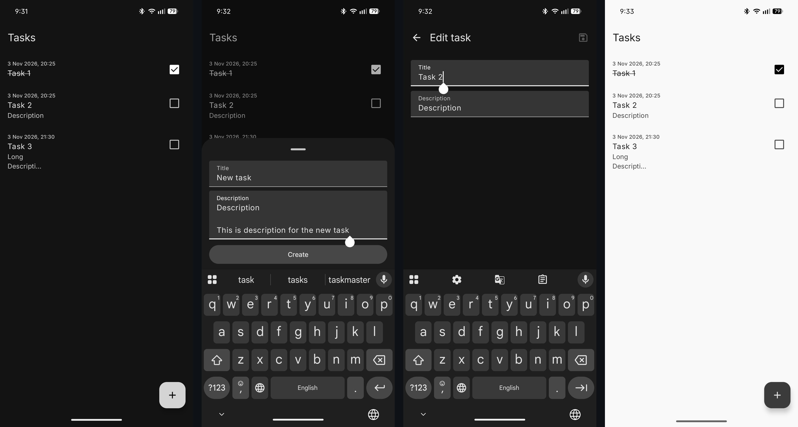
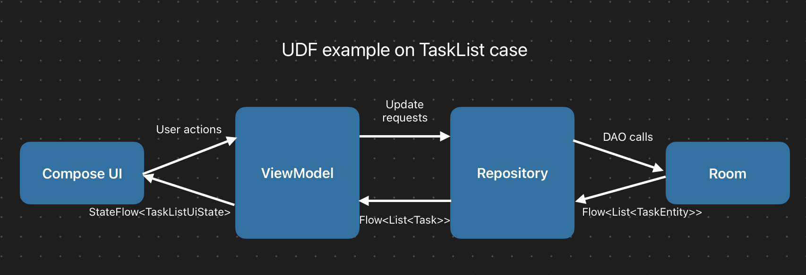

# ReelTusky

A small, local-first Android task tracker built with Kotlin, Jetpack Compose, and Material 3.

Create tasks, edit their details, mark them as complete, and swipe to delete with an Undo action.
Tasks are stored locally with Room and remain available after restarting the app.

This is a learning project focused on Android architecture, state management, persistence,
dependency injection, and testing. It started with an in-memory repository and manual dependency
injection, then moved to Room and Hilt.

## Features

- Create tasks in a modal bottom sheet with a required title and an optional description.
- Edit existing tasks on a separate screen.
- Mark tasks as complete or incomplete.
- Swipe to delete and restore a task using the Snackbar's Undo action.
- Keep tasks across app restarts using a local database.
- Support light and dark themes.
- Preserve editor input across configuration changes and prevent repeated saves while saving.

## Screenshots



From left to right — task list, add task, edit task, and light theme.

## Tech stack

- **Kotlin** and **Kotlin Coroutines / Flow**
- **Jetpack Compose** and **Material 3**
- **AndroidX ViewModel**
- **Navigation Compose 2**
- **Room** for local persistence
- **Hilt** for dependency injection
- **KSP** for Room and Hilt code generation
- **JUnit 4**, **kotlinx-coroutines-test**, **Turbine**, and **Compose UI testing**

Dependency versions are maintained in [gradle/libs.versions.toml](gradle/libs.versions.toml).

## Architecture

The app uses MVVM with unidirectional data flow and packages organized by feature.



Each screen separates state collection and ViewModel access (`…Screen`) from UI rendering
(`…Content`). Content composables receive state and callbacks, which makes them usable in previews
and UI tests without a ViewModel or database.

ViewModels expose a single UI state and handle user actions. The repository owns task IDs and
creation timestamps, while Room entities are mapped to plain task models. Hilt supplies the
database, DAO, repository, and ViewModel dependencies. The editor receives its task ID from
navigation through an assisted factory.

```text
app/src/main/java/com/rayxaus/reeltusky/
├── data/             # Task model, validation, and repository contract
│   └── local/        # Room database, DAO, entities, and repository implementation
├── di/               # Hilt database and repository modules
├── navigation/       # Type-safe routes
└── ui/
    ├── components/   # Shared UI components
    ├── tasklist/     # Task list, creation sheet, and list ViewModel
    ├── taskedit/     # Editor UI, ViewModel, and assisted factory
    └── theme/        # Compose theme
```

## Run locally

### Requirements

- Android Studio with support for the project's Android Gradle Plugin version (see the version
  catalog).
- Android SDK Platform **37** for compilation.
- A device or emulator running **Android 8.0 / API 26** or newer.
- The project specifies **JDK 25** for the Gradle daemon in `gradle/gradle-daemon-jvm.properties`.
  Allow Gradle to provision it or make it available locally.

### Android Studio

1. Clone or download this repository and open its root directory in Android Studio.
2. Let Gradle sync and install any required SDK components.
3. Select the `app` run configuration and a device or emulator.
4. Run the app.

No API keys, server configuration, or credentials are required. A fresh installation starts with an
empty task list.

### Command line

Run the commands below from the repository root. Make sure a JDK is available through `JAVA_HOME`
or `java` on your `PATH` so the Gradle wrapper can start. Using JDK 25 matches the project's daemon
configuration.

Ensure the Android SDK is configured through `ANDROID_HOME` or an untracked `local.properties` file
containing `sdk.dir`.

Build a debug APK:

```sh
./gradlew :app:assembleDebug
```

The APK is written to `app/build/outputs/apk/debug/app-debug.apk`.

Install it on a connected device or running emulator:

```sh
./gradlew :app:installDebug
```

For a physical device, enable USB debugging and accept the computer's debugging authorization
prompt. Check the connection with `adb devices` before installing. The `adb` command is included
in Android SDK Platform-Tools. Add that directory to your `PATH` to use it from the terminal.

After installation, open ReelTusky from the device's app launcher or start it from the terminal

```sh
adb shell am start -n com.rayxaus.reeltusky/.MainActivity
```

On Windows, use `gradlew.bat` instead of `./gradlew`.

## Tests

Run local JVM tests:

```sh
./gradlew :app:testDebugUnitTest
```

Run instrumented tests with a device or emulator connected:

```sh
./gradlew :app:connectedDebugAndroidTest
```

The test suite covers title validation, ViewModel state and actions using a fake repository, Room
operations using an in-memory database, deletion and restoration with preserved fields and ordering,
editor controls and callbacks, and the swipe → Undo regression in the task list.

Local tests live in `app/src/test`; Room integration tests and Compose UI tests live in
`app/src/androidTest`.
